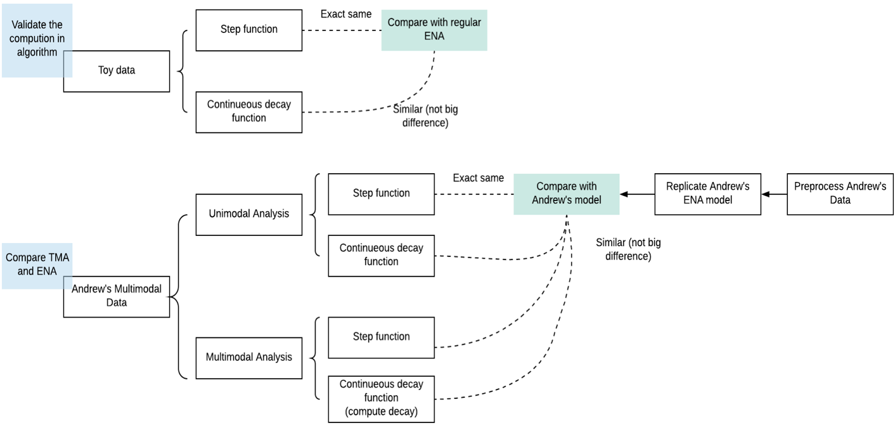

# Transmodal Analysis

## Analysis Plan

TODO:

[X] Generate toy/dummy dataset (`test_data.csv`)
[] Generate continuous decay function
[] Replicate unimodal findings using ENA using TMA
    [X] using toy dataset
    [] using TADMUS
    [] using Heads and Hands dataset
[] Test on real multimodal dataset

